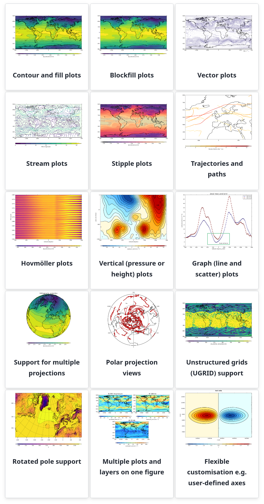

*************************
Documentation for cf-plot
*************************

**cf-plot: code-light plotting for earth science and aligned research**

.. Define external links to use in the docs here

.. _matplotlib:  https://matplotlib.org/
.. _Cartopy:     https://scitools.org.uk/cartopy/docs/latest/
.. _cf-python:   https://ncas-cms.github.io/cf-python/
.. _NCAS-CMS:    https://cms.ncas.ac.uk/index.html
.. _NCAS:        https://ncas.ac.uk/

########
Overview
########

cf-plot allows you to produce and customise publication-quality contour, vector,
line and more plots with the power of Python, `matplotlib`_,
`Cartopy`_ and `cf-python`_ in as few lines of code as possible.

It is designed to be a useful visualisation tool for environmental, earth and
aligned sciences, for example to facilitate climate and meteorological research.
cf-plot is developed and maintained by the `NCAS-CMS`_ group, part of `NCAS`_.

Learn more about cf-plot in the :ref:`intro` section, else navigate via
the contents listing as shown below and in the navigation sidebar.

########
Contents
########

.. toctree::
   :caption: Contents
   :maxdepth: 2

   introduction
   installation
   plot_types
   gallery_of_examples
   api_reference
   configuration_guide
   colour_scales
   versions
   support
   training
   license

   .. Temporarily removed, since these are old and need updating:
      user_guide
      advanced

----

################
Index and search
################

* :ref:`genindex`
* :ref:`Search <search>`

